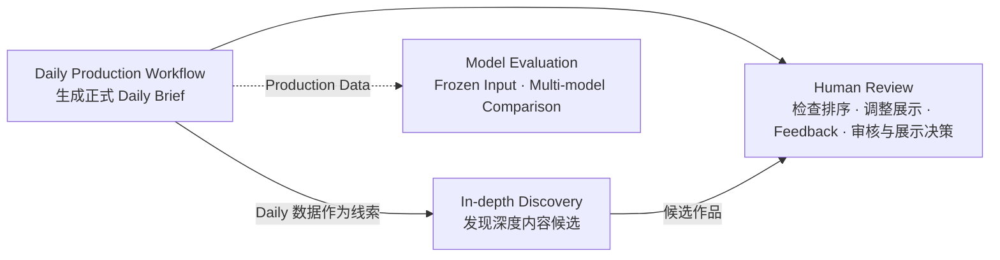
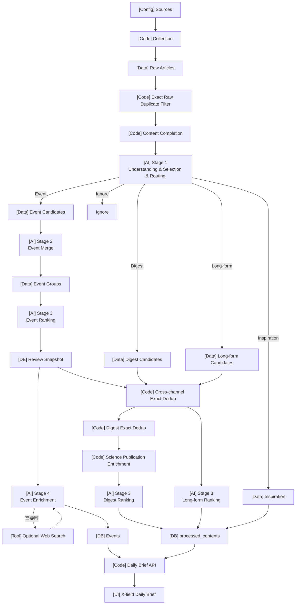
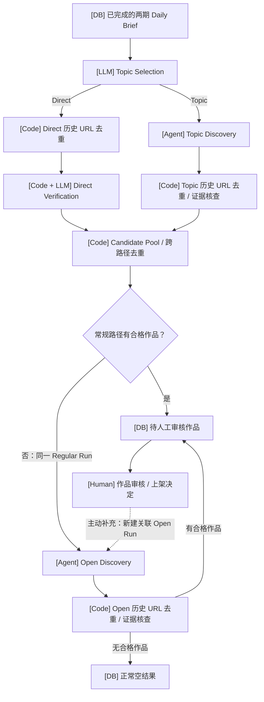
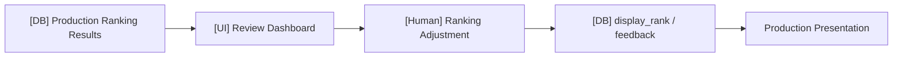
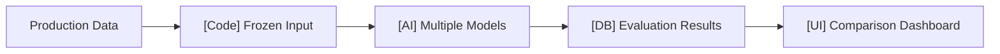
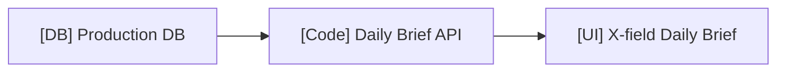

# X-AI-field Workflow Overview

本文档只描述 X-AI-field 当前系统的**高层工作流和主要模块关系**。

具体规则分别由对应 Source of Truth 定义：

- AI 判断语义 → `03-ai-workflow-spec.md`
- Daily Production Pipeline 执行、scope、retry、persistence、lineage → `06-workflow-spec/daily.md`
- Discovery 执行流程、分支与验证规则 → `06-workflow-spec/discovery.md`
- 数据结构与关联 → [Data Model](05-data-model/README.md)
- Prompt / Structured Output → `00-index.md#prompt-contracts`
- Commands / Tests / Diagnostics → `09-operations.md`

---

## 1. System Overview

X-AI-field 包含两条独立的内容生产工作流，以及 Human Review 和 Model Evaluation：

- **Daily Production Workflow**：生成正式 Daily Brief 数据。
- **In-depth Discovery**：独立运行，消费已完成的 Daily 数据，寻找深度作品并提交人工审核；不修改 Daily Production Workflow。
- **Human Review**：分别审核 Daily 排序 / 展示，以及 Discovery 提交的作品；两者的审核对象和操作不同。
- **Model Evaluation**：独立旁路，在相同 Frozen Input 下比较不同模型，不修改 Production 数据。

---

## 2. Production Workflow

节点前缀表示主要职责：

- `[Config]`：配置
- `[Code]`：确定性代码处理
- `[Data]`：Pipeline 中间数据
- `[AI]`：LLM 判断或生成
- `[DB]`：持久化边界
- `[Tool]`：按需调用的外部工具
- `[UI]`：用户界面

这张图只表达主要数据流。具体 dedup、enrichment、Review Snapshot、ranking persistence、retry 和 lineage 等执行规则见 `06-workflow-spec/daily.md`。

---

## 3. Daily 的四个 AI Stages

| Stage | High-level responsibility |
|---|---|
| Stage 1 | 单篇内容：理解、筛选、Routing |
| Stage 2 | Event Candidates：判断哪些报道属于同一现实事件 |
| Stage 3 | 各 Channel：判断相对重要性 / 阅读价值 |
| Stage 4 | Selected Events：生成最终事件内容，必要时 Web Search 补充外部上下文 |

AI 判断规则见 `03-ai-workflow-spec.md`；Prompt、Structured Output 和模型 Contract 见 `00-index.md#prompt-contracts`。

---

## 4. In-depth Discovery Workflow

- **Direct**：验证 Daily 中具备可用正文的单篇作品；**Topic**：由 Agent 围绕知识问题搜索、阅读外部作品。
- **Open Discovery**：常规路径没有合格作品时自动运行；人工审核后也可以独立发起补充 Open Run。
- **审核边界**：机器选出的作品先进入待审核数据，不自动上架。

运行窗口、具体输入规则、URL 去重时机、内容验证、候选数量、失败与重跑见 `06-workflow-spec/discovery.md`；Agent / LLM 判断语义见 `03-ai-workflow-spec.md`。

---

## 5. Human Review Workflow

本节图示的是 **Daily Human Review**：不重新执行完整 Production Pipeline，用于检查 AI Ranking、调整最终展示顺序并留下反馈；当人工调整导致最终展示需要尚未生成的 Event 内容时，可以复用 Production 的 Event Enrichment 能力。Discovery 作品审核由上一节的独立候选链路进入，不共用 Daily 排序调整流程。

具体执行和 persistence 规则见对应 Processing / Data Model Spec。

---

## 6. Model Evaluation Workflow

Model Evaluation 用于在**相同输入**下比较不同模型的结果。它独立于 Production Daily Workflow：

- 不由 Daily Workflow 自动触发；
- 不修改正式 Event、Content、Ranking 或 Feedback；
- Evaluation 结果只用于 Observation / Comparison；
- 当前 MVP 不评估 Stage 4。

具体运行命令见 `09-operations.md`。

---

## 7. Daily Brief Output

Production 最终形成：

| Section | Production data |
|---|---|
| Today's Events | `events` |
| Source Digests | `processed_contents`(routing=digest + rank) |
| Long-form Reads | `processed_contents`(routing=long_form + rank) |
| Daily Inspiration | `processed_contents`(routing=inspiration) |

最终展示链路：

具体表结构和字段定义见 [Data Model](05-data-model/README.md)。
