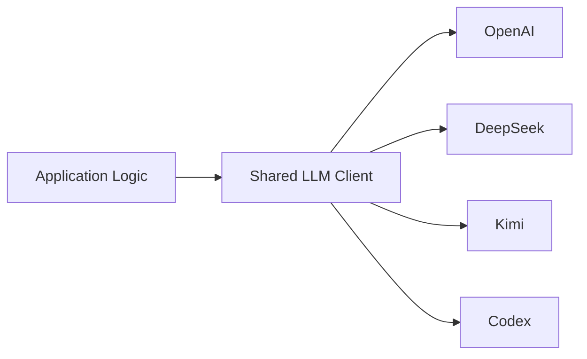

# X-AI-field Technical Spec

本文档定义 X-AI-field 当前的技术架构、系统边界、模块职责与稳定工程约束。

---

## 1. System Architecture

MVP 采用简单的三层架构：

```text
Data Layer → Processing Layer → Presentation Layer
```

应用保持 Next.js + PostgreSQL 架构，不引入外部消息队列或 Workflow Engine。Web 与 Discovery Worker 是独立进程，共享代码和数据库；Discovery 使用数据库持久化任务，不是进程内后台 Promise。Daily 与 Discovery 是独立任务。Daily 执行规则见 `../06-workflow-spec/daily.md`，Discovery 执行规则见 `../06-workflow-spec/discovery.md`，其技术实现边界见 `discovery.md`。

### 1.1 Data Layer

核心数据关系：

```text
sources
  ↓
raw_articles
  ↓
processed_contents
    ├── Event Candidate → Event Groups → Review Snapshot → Stage4 → events
    ├── Source Digest
    ├── Long-form
    └── Inspiration


feedback

evaluation_inputs → evaluation_runs → evaluation_outputs
```

- `sources`：Source List 与采集配置
- `raw_articles`：Collector 标准化后的原始内容
- `processed_contents`：Stage 1 处理后的内容，Ignore 不入库
- `events`：最终生成并用于展示的 Event
- `event_review_items`：Event Ranking Human Review 的快照；与最终 Event 的关系见 [Daily](daily.md)
- `feedback`：人工 Review 产生的反馈数据
- `evaluation_*`：Model Evaluation 使用的冻结输入、模型运行与输出，与正式 Production 结果隔离

具体表结构、字段、约束、关系与索引以 `../05-data-model.md` 为准。

## 2. Tech Stack

- Runtime：Next.js + TypeScript
- Database：PostgreSQL / Supabase
- ORM：Drizzle ORM
- AI Integration：Daily / 常规结构化调用使用共享 LLM compatibility layer；Discovery 自适应探索使用 OpenAI Agents SDK（TypeScript）
- Supported Providers：OpenAI / DeepSeek / Kimi / Codex（各调用路径的能力与配置以适配器为准）
- Structured Output：Provider 输出 + Application Schema Validation
- External Retrieval：Daily Stage 4 可选 `web_search`；Discovery 优先使用 Agents SDK 托管 Web Search
- Scheduling：Cron / Scheduled Job
- Runtime Artifacts：Daily 等既有流程使用本地文件系统（Git ignored）；Discovery Trace 存 PostgreSQL

---

## 3. Data Model

PostgreSQL 是 Production System of Record。

Production 数据主要包括：

```text
Production Content Data
Review / Feedback Data
Model Evaluation Data
Discovery Runs / Candidates / Trace Data
```

数据库负责持久化业务内容、Review 和 Discovery 执行状态。Daily 的 `runtime/` 保存运行级 artifacts 及明确用于 Resume 的元数据，不替代 Production 内容表。Trace 是诊断记录，不是业务状态或正文缓存；失败隔离见 [Discovery](discovery.md#6-数据持久化与执行追踪)。

详细表结构、字段、关系、约束和索引定义见 `../05-data-model.md`。

---

## 4. Web、Worker 与 CLI

- `src/app/` 负责 HTTP / Server Components；可复用业务服务在 `src/lib/`、`src/processing/`、`src/discovery/`，Route 不复制 Pipeline。
- Daily CLI 执行 Daily Workflow；Discovery CLI 可直接执行，Dashboard / Scheduled CLI 仅提交持久化任务，独立 Worker 执行。
- Discovery 执行者共享数据库全局执行锁；HTTP 提交锁与执行锁职责不同。锁和恢复边界见 [Discovery §7](discovery.md#7-运行入口人工触发与失败处理)。

## 5. LLM Integration

常规 LLM Integration 通过共享 compatibility layer 与业务逻辑解耦。Discovery 的 Agent Loop 单独通过 Agents SDK 接入；二者共用业务契约，不要求复用同一个 SDK Client：



生产 Prompt 文本唯一来源是数据库中精确绑定的 Published Version。`src/lib/prompts/runtime.ts` 在执行上下文中加载并缓存，失败不使用静态 fallback；Evaluation 复用同一生产调用链。`src/prompts/` 仅保存动态输入 builder、类型和历史标签，运行模块不得依赖初始化 Seed 或历史 Fixture。

模板、角色和精确 Fragment 契约见 `../07-prompt-spec/registry.md`；存储与版本载体见 `../05-data-model.md` §12；Daily / Discovery 的恢复特例见对应 Workflow。LLM Client、Provider、Schema 和工具仍由代码管理。

### 5.1 Structured Output 边界

```text
Application Input
→ LLM Request
→ Structured Output
→ Application Schema Validation
→ Business Logic / Persistence
```

不同 Provider 的原生 Structured Output 能力可以不同，但输出在被业务逻辑使用或持久化之前，都必须通过相同的 Application-side Contract Validation。

### 5.2 Provider Independence

系统通过共享 LLM Client 支持不同 Provider，使模型或 Provider 可以替换，而不要求修改对应 Workflow 的业务逻辑。具体 Provider 配置与环境变量属于运行配置，不在本节重复定义。

### 5.3 工具与外部输入

检索工具和 Structured Output 仍由代码控制，不随 Prompt 文本任意扩张。外部文章内容是资料而非系统指令。Stage4 的可选检索路径见 [Daily](daily.md)，Discovery Agent 的工具、预算与证据边界见 [Discovery](discovery.md#4-ai-调用与-agent-runtime)。

## 6. 数据库连接边界

`src/db/index.ts` 延迟创建进程级 Web Pool；Worker、Discovery CLI 和 Scheduled 提交进程各自创建 Pool，不能将多个进程的连接额度视为一份。配置集中于 `src/db/pool-options.ts`：按进程职责设置容量及有限的连接等待超时，不依赖扩大 Pool 解决事务内二次取连接。

Session Advisory Lock 必须使用直连或 Session Pooling。执行者和 Read More 生成者占用的锁连接也是连接预算的一部分；数据库实际额度、Pooler 模式和网络超时需在部署环境核验，代码默认值不是服务器容量保证。具体锁生命周期见 [Discovery](discovery.md)，部署与配置入口见 [Operations](../09-operations.md)。

## 7. API 与数据发布边界

X-AI-field 提供生产数据和管理后台，X-field 是独立读者端。公开 API 显式投影允许展示的字段；后台 API 独立鉴权，不能只依赖页面或 Sidebar。路由、同源保护、发布过滤及错误语义由 [Admin & API](admin-api.md) 定义。

## 8. Project Structure & Engineering Rules

### 8.1 Project Structure

项目保持相对平铺的目录结构：

```text
X-AI-field/
├── src/
│   ├── app/            # HTTP Routes / Internal Dashboard UI
│   ├── collectors/
│   ├── db/
│   ├── lib/
│   ├── processing/
│   ├── discovery/     # In-depth Discovery 独立模块
│   └── prompts/         # 动态输入 builder / 类型 / 历史日志标签，无静态指令
├── scripts/
├── drizzle/
├── runtime/
├── docs/               # 完整文档导航见 docs/00-index.md
├── AGENTS.md
└── README.md
```

Technical Spec 维护目录级职责，不需要镜像每一个具体 Source File。

### 8.2 Module Boundaries

- `collectors`：外部数据采集与标准化。
- `processing`：Daily Production Processing、Review / Evaluation Services 与相关 Persistence Orchestration。
- `discovery`：独立 Discovery Workflow 编排、Agent、候选验证与持久化协调；不依赖 Daily Stage 内部执行入口。
- `prompts`：动态输入 builder、类型和历史标签，不提供生产静态 Prompt。数据库文本加载、版本解析与绑定由 `src/lib/prompts/` 管理。
- `db`：Database Schema 与 Connection。
- `lib`：共享 Application Logic 与 API Composition Helpers。
- `app`：HTTP Routes 与 Internal UI。
- `runtime`：运行级 Operational / Debug Artifacts。
- `scripts`：CLI Entry Points 与专用 Operational Tools。

核心业务逻辑应放在可复用的 Application / Processing Modules 中，不应重复写入 Route Handler、UI Component 或 CLI Script。

### 8.3 Dependency Direction

优先保持依赖方向：

```text
app / scripts
    ↓
application / processing modules
    ↓
db / llm / external adapters
```

除非逻辑确实只属于对应 Boundary，否则不要把核心业务行为直接放入 UI Component、API Route Glue、CLI Entry Point 或 Runtime Artifact Reader。

### 8.4 Engineering Rules

- KISS
- YAGNI
- 同一事实只在唯一 Source of Truth 中定义
- 模块保持单一、清晰职责。
- 优先显式代码，不做过早抽象。不为假设中的未来规模提前引入基础设施。
- 通用基础能力优先使用成熟 Library。
- 不静默忽略错误。
- Secrets 与环境相关配置不得硬编码。
- Model / Provider 应保持可替换。
- Structured AI Output 必须验证后再使用。

### 8.5 Error Handling

- 错误尽量在最接近发生位置处理并记录；
- 无关工作能够安全继续时，应隔离局部失败；
- 保留足够信息支持针对性 Retry 与 Diagnosis；
- 不通过 Silent Fallback 隐藏异常。

Daily 的 Step Retry / Recovery 语义见 `../06-workflow-spec/daily.md`；
Discovery 的失败与重跑语义见 `../06-workflow-spec/discovery.md`；Operational Commands 见 `../09-operations.md`。

### 8.6 Testing Boundary

测试应保护会造成实质性 Regression 的架构与行为 Contract。具体 Test Commands 与 Test Inventory 见 `../09-operations.md`。

---

## 9. Runtime Architecture

`runtime/` 保存 Production Processing 与相关工具生成的 Run-level Artifacts。

用于保存 Model Input / Output、Run Metadata 与运行诊断，辅助失败调查；记录完整度以各流程实际写入为准，不承诺完全 Replay。

### 9.1 Runtime 不是 Production State

Runtime Artifacts：

- Git ignored；
- 不是 Application Database；
- 不替代数据库中的 Production 内容与发布状态；
- 不应静默成为 Processing Stages 之间的正式数据接口。

Daily 的 `run.json` Prompt 绑定属于显式 Resume 契约，采用原子文件写入；Stage4 则以数据库 `stage4_runs.prompt_versions` 为权威，文件仅同步记录。不能将这一例外推广为从 artifacts 重建 Production State；版本契约见 [Prompt Registry](../07-prompt-spec/registry.md)。

### 9.2 Runtime 与 Dashboard

Internal Dashboard 可以读取 Runtime Artifacts，用于 Daily Job Report 与历史运行 Diagnostics。

当 Runtime 数据不存在时，不应根据当前 Production State 反推出虚假的历史 Runtime Metrics。

### 9.3 Runtime 与 Recovery

Runtime Artifacts 可以在明确需要时辅助 Debug 与 Recovery Analysis，但 Recovery Semantics 应由 Processing Workflow 定义，而不是依赖未文档化的文件系统约定。

Daily 执行语义见 `../06-workflow-spec/daily.md`；
Discovery 执行语义见 `../06-workflow-spec/discovery.md`；
操作规程见 `../09-operations.md`。
